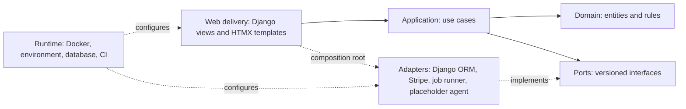

## Context

Cognify is an early-stage, paid educational assessment workflow. Student data
may concern minors. The current repository contains no application structure.
This proposal specifies the system before implementation; it does not define an
exam or a diagnostic method.

## Goals and Non-Goals

Goals: a polished local demo, strong business-logic boundaries, safe persistence
and background execution, and a documented path to a cloud-hosted production
runtime without rewriting use cases.

Non-goals: real diagnostic output, external AI integration, cloud-provider
selection, cloud deployment, high-scale infrastructure, and multiple adapters
for a port.

## Technical Approach

### Layers and Dependency Rules

The arrow indicates compile-time dependency. Domain imports no outer layer.
Application depends on domain and port contracts only. Adapters depend inward to
implement ports. Web invokes application use cases and is the composition root;
views do not contain business rules. Enforce package boundaries with
import-linter contracts in CI, including that Django and Stripe SDK imports are
confined to outer layers.

### Port and Adapter Map

| Port | Initial runtime adapter | Boundary |
| --- | --- | --- |
| PaymentProvider | Stripe | Checkout, verified webhooks, customer/entitlement operations |
| AnalysisAgent | One deterministic placeholder | Versioned request/result; no real analysis or external AI |
| JobRunner | One selected maintained DB-backed runner | Persistent enqueue/status/retry; replace without changing use cases |
| StudentRepository | Django ORM adapter | User-scoped persistence |
| ReportRepository | Django ORM adapter | User-scoped, idempotent report persistence |
| Anonymizer | One application-owned implementation | Removes/replaces direct identifiers before analysis |
| UIComposition | Django + HTMX adapter | Maps use cases to templates; replaceable without use-case changes |

Do not build fake runtime adapters for tests. Use focused test doubles only at
external boundaries and Stripe test mode for payment integration tests.

### Versioned Data Contracts

Every cross-port payload has a schema identifier and version. The initial
`TestDataEnvelope` carries only the student reference needed for application
ownership, a caller-provided opaque data schema identifier/version, and a
validated bounded mapping of generic values. It does not name exam questions or
encode scoring. The analysis request carries a pseudonymous subject reference,
the envelope, request idempotency key, and contract version. The result carries
the request key, contract version, completion status, and explicitly labeled
placeholder content. Unsupported versions and invalid or oversized payloads
fail with stable typed errors.

The placeholder output is deterministic for a given validated request and is
visibly marked as demo-only/non-diagnostic in storage and presentation. It must
not infer or invent learning difficulties.

### Jobs, Reports, and Billing Safety

Job payloads are versioned and contain stable request/idempotency identifiers,
not unnecessary direct identifiers. Persistent state transitions are explicit:
queued, running, succeeded, failed, and cancelled where supported. Worker
retries are bounded and safe under at-least-once delivery. Use database
uniqueness/transactions for request-to-report and payment-event identities.
Reserve/deduct credits exactly once; define compensation for terminal failure.
Webhook signature verification precedes processing, and event replay is
idempotent.

Select the DB-backed runner only after verifying maintenance, Django support,
task persistence, locking/concurrency, retry controls, restart behavior, and
failure observability. Document SQLite demo concurrency limitations. Future
production alternative: a managed queue/worker service appropriate to the
eventually selected cloud. A future approved change may replace the adapter and
worker deployment while retaining the JobRunner port, versioned payload, and
database idempotency records. A replacement adapter must pass the same port
contract suite before the deployment is switched. Add Celery/broker operation
only if a concrete reliability or throughput requirement warrants it.

### Deployment and Operations

Use one reproducible Docker image with explicit separate web and worker entry
commands. Local/demo uses SQLite; production uses PostgreSQL through environment
configuration and the same repositories/use cases. Django migrations own schema
changes. Production persistent data must live in the database or a separately
specified durable storage port, never the container filesystem. Collect static
assets during build/release and serve through a documented maintained option;
do not use Tailwind CDN in production.

Separate development and production settings. Production requires a secret key,
database URL, allowed hosts, HTTPS/proxy trust configuration, and explicit
payment configuration as applicable. Fail closed for missing/invalid settings;
set `DEBUG=False`; enable secure session/CSRF cookies, CSRF protection, secure
headers, and HTTPS redirects/HSTS according to the selected proxy topology.
Trust forwarded HTTPS headers only from the configured trusted proxy. Keep
secrets in environment variables or a cloud secret manager; commit only a safe
`.env.example`.

Expose liveness/readiness health checks without leaking sensitive data. Emit
structured logs with request/job correlation identifiers and no student payloads,
secrets, or direct identifiers. GitHub Actions runs tests, Ruff, mypy,
import-linter, Bandit, pip-audit, Django production checks, migration checks,
and Docker image build. No production deployment job is enabled by default.

Deployment migration sequence: provision PostgreSQL and secrets; verify a
restorable backup; deploy the immutable image; apply backward-compatible Django
migrations as a release step before starting the new web/worker processes; run
health/readiness checks; then route traffic. Prefer expand/contract migrations
for incompatible schema changes. Roll back application images only when the
current schema remains backward-compatible; for irreversible data/schema
changes, use a documented forward fix or restore procedure, not an assumed
automatic reverse migration.

Document local setup, configuration, Docker, web/worker startup, migrations,
static assets, deployment prerequisites, backups/restores, upgrade/rollback,
logging, health, and troubleshooting. Backups must cover PostgreSQL and any
approved durable media; restore procedures must be tested before launch.

### Security and Privacy

Users can access only their own records, jobs, reports, and billing state.
Validate at HTTP, CSV, use-case, and adapter boundaries. Apply rate limits to
authentication, CSV, analysis requests, and payment-sensitive routes. Minimize
stored student data; pseudonymize before any AnalysisAgent call. Specify
retention/deletion and obtain jurisdictional review for minors and educational
or potentially regulated assessment data before production launch.

### Testing Strategy

Each Phase B change includes focused unit and integration tests plus contract
tests for the adapter it introduces. Test unauthorized cross-user access,
invalid schemas, CSV row errors, anonymization, duplicate/retried tasks,
duplicate webhook events, quota accounting, migration behavior on SQLite and
PostgreSQL, production-settings fail-closed behavior, and documented Docker
startup. Quality gates are defined in the constitution.

## Decisions and Open Questions

- Use Python, Django, HTMX, Tailwind, uv, Ruff, mypy, import-linter, Bandit,
  pip-audit, SQLite for local/demo, and PostgreSQL for production.
- Use Stripe as the sole initial PaymentProvider; credits first. Defer
  per-student subscriptions while preserving an entitlement model extension.
- Choose a Hebrew-capable self-hosted font with compatible licensing.
- Evaluate a maintained static-asset serving option such as WhiteNoise; confirm
  operational fit before selecting it.
- Verify current runner maintenance and reliability before selecting its
  package. No Redis, Celery, or cloud provider is selected.
- Open: target jurisdiction, data residency, consent, retention duration,
  deletion/export process, production hosting provider, exact CSV schema, and
  backup RPO/RTO. These are launch decisions, not reasons to invent behavior.